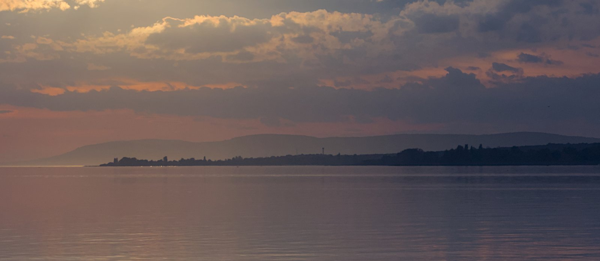

{fig-alt="A Balaton alkonyatkor"}

# Üdv a honlapomon!

Környezetmérnöki hátterű kutatóként édesvízi ökológiával, fitoplanktonnal és ökológiai modellezéssel foglalkozom. Azzal a céllal hoztam létre ezt a honlapot, hogy a munkámhoz és szakmai érdeklődésemhez kapcsolódó posztokon keresztül érthetőbbé tegyem a tudományos gondolkodás és az adatok szerepét korunk környezeti kihívásainak értelmezésében.

**Pálffy Károly**  
kutató  
[Balatoni Limnológiai Kutatóintézet](https://www.blki.hun-ren.hu)
