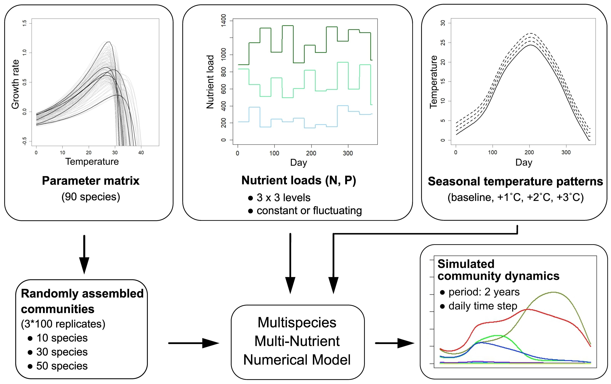
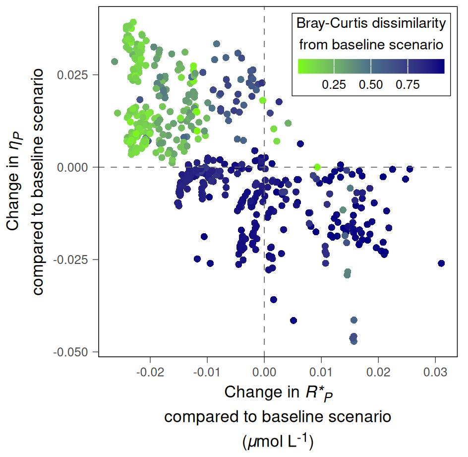

A globális felmelegedés korunk egyik legsürgetőbb problémája, melynek eredményeképpen kiterjedt kutatások indultak e hosszútávú változás hatásainak vizsgálatára. Számtalan ökológiai tanulmány foglalkozik az ökoszisztémák szerkezetében jelentkező változások dokumentálásával, ugyanakkor a legfontosabb kérdés mégis az, hogy **a klímaváltozás milyen módosulást okoz az ökoszisztémák működésében és az azokhoz kapcsolódó folyamatokban**. A mérsékelt öv sekély tavai egyértelműen azok közé a rendszerek közé tartoznak, amelyek különösen érzékenyek az éghajlatban mutatkozó változásokra. E tekintetben, a nyíltvízi életterek legfontosabb elsődleges termelőjeként, a fitoplankton szerepe is figyelmet érdemel.

](/images/oreilly_2015_fig1.jpg){width="80%"}

A fentiek fényében, [legújabb cikkemben]() a következő kérdésre kerestem a választ: ha a klímaváltozás összetételbeli és fenológiai változásokat okoz a fitoplanktonban, milyen következmények várhatók ezen közösségek működésében? Hogyan reagál a fitoplankton ezekre a változásokra sekély tavakban, és ez hogy és milyen mértékben hat ki az ökoszisztéma folyamatokra?

A fitoplankton közösségek dinamikája, az általuk befolyásolt ökoszisztéma folyamatok és a környezet közötti kölcsönhatásokat számtalan mechaniszikus kapcsolat alakítja. Az algák egyik kulcsfontosságú ökológiai funkciója a szerves anyagban kötött tápanyagok és energia biztosítása fogyasztóik számára. Mivel mind a hőmérséklet, mind a szervetlen tápanyagok mennyisége kölcsönösen kihat az algák biomassza gyarapodására (és ezáltal a tápanyagfelvételükre is), feltételezhető, hogy **a hőmérséklet hossszútávú emelkedése módosíthatja a fitoplankton működéséhez kötődő tápanyafluxusokat**. Ennek feltárása azonban komoly kihívás, többek között azért, mert a klímaváltozással a hőmérséklet éves mintázata is módosul. Így bármilyen felmelegedés okozta, ökoszisztéma szintű hatás a szezonalitás figyelembe vétele nélkül nehezen mérhető fel, különösen igaz ez a mérsékelt éghajlati övre. További nehézséget okoz, hogy a különböző környezeti gradiensek mentén realizálódó funkcionális válaszgörbék **fajspecifikusak**, ami **jelentős varianciát eredményez a közösségi szintű válaszreakciók tekintetében**. Ezen felül az egyébként nélkülözhetetlen, hagyományos terepi és kísérletes megközelítések, értelmezésük korlátai miatt, nem elegendők az ökoszisztémákban zajló folyamak teljes körű megértéséhez. Ezen a ponton válhatnak az un. dinamikus vagy folyamatmodellek hatékony kutatási eszközzé.

Jelenlegi tanulmányom egy korábban megjelent cikkünkre épül ([Pálffy & Smeti, 2024, Limnol. Oceanogr., 69: 1056-1069.](https://doi.org/10.1002/lno.12548), melynek alapját egy hőmérséklet- és tápanyagfüggő közösségi modell képezi. A modellel random összetételű fitoplankton közösségek szezonális dinamikáját vizsgáltuk, különböző nitrogén (N) és foszfor (P) utánpótlás, és négy hőmérsékleti forgatókönyv mellett futtatott szimulációkban.

{width="90%"}

A fajösszetételbeli változások egyoldalú vizsgálata helyett a szimulációk fókusza **a közösségek tápanyagfelvételi dinamikájának és hatékonyságának vizsgálatára** helyeződött. A cél annak vizsgálata volt, hogy **bizonyos funkcionális jellegek felmelegedés okozta módosulása mi módon kapcsolódhat a tápanyagfelvétel változásához**. E fajspecifikus jellegek közül az un. **minimális erőforrásigény** (*R\**, az a tápanyagkoncentráció, amely mellett egy faj szaporodási és mortalitási rátája egyensúlyban van) egyúttal egy tápanyag-felvételi küszöbértéknek is tekinthető. Ez az a (fajonként eltérő) minimum szint, ameddig a rendelkezésre álló tápanyagkészlet kiaknázható.

Ezen a jelleg-működés kapcsolaton alapulva a kutatás **kezdeti hipotézisében** azt feltételeztem, hogy az átlaghőmérséklet hosszútávú emelkedésével nő a fitoplankton tápanyagfelvételi hatékonysága, ami pozitív összefüggést mutat a fajösszetétel változásának mértékével és negatív összefüggést a minimállis erőforrásigény súlyozott átlagával. A szimulációk elemzése részben cáfolta a hipotézist:

1. **A felmelegedés hatására éves szinten kiegyenlítettebbé vált a fitoplankton tápanyagfelvétele és nőtt annak hatékonysága.** A vártaknak megfelelően ez elsősorban a nettó növekedési periódus kiszélesedésének volt köszönhető, azonban a hatás mértékét a szervetlen N és P utánpótlás aránya (N:P) és az összetétel változása is befolyásolta.

2. A hipotézissel ellentétben, **azokban a közösségekben, ahol a magasabb átlaghőmérséklet okozta fajkicserélődés nagymértékű volt, a tápanyagfelvétel elért növekménye mérsékeltebb volt, ami egybeesett a súlyozott *R\** növekedésével**. Ez az összefüggés különösen a tápanyag-limitált nyári időszakban vált jelentőssé. Az eredmény ugyanakkor további kérdéseket is felvet, mivel a modell fajspecifikus paramétereinek becslése szakirodalmi adatok felhasználásával történt, és e tekintetben még jelentős az ismerethiány. Annak megállapításához, hogy a kimutatott jelenség mennyire lehet gyakori természetes körülmények között, szükséges volna megérteni, hogy a környezeti változókra adott fajszintű válaszreakciók tekintetében különböző algacsoportokban mekkora inter- és intraspecifikus varianciával számolhatunk.

{width="70%"}

3. Ha a szimuláció során a rendszerbe táplált tápanyag időben ingadozott, **nagyobb mértékű fluktuáció mellett a felvételi hatékonyság melegedés okozta növekménye is emelkedett**, függetlenül a minimállis erőforrásigény változásától.

{width="70%"}

**Az eredmények szerint a felmelegedés fitoplankton tápanyagfelvételre gyakorolt hatása jelentősen függ a közösség funkcionális válaszához kötődő jellegek szerkezetétől éppúgy, mint a nitrogén és foszfor bevitel arányától és időbeli varianciájától. A kimutatott ellentétes hatások arra utalnak, hogy a közösségösszetétel változásának mértéke és a környezeti változókra jellemző variancia döntően befolyásolhatja a fitoplankton klímaváltozásra adott válaszreakcióját.**

Fontos leszögezni, hogy a tanulmányban szereplő számítások nem térnek ki további befolyásoló tényezőkre, pl. a fény vagy a fitoplanktont fogyasztó szervezetek hatására. Az is belátható ugyanakkor, hogy az összes tényező együttes figyelembevétele esetén a munka eltért volna eredeti célkitűzésétől, és egyben drasztikusan növelte volna a modell komplexitását és a szükséges számítási kapacitást.

További információ a cikkel kapcsolatban:

* a Journal of Plankton Research honlapján, [itt]()
* a cikk szerzői (a megjelenttel tartalmilag azonos) verziójában, ami innen letölthető:
```{=html}
<div class="mb-3">
  <button type="button" class="btn btn-outline-primary" data-bs-toggle="modal" data-bs-target="#cvModal">
    PDF megtekintése
  </button>
  <a href="/files/Palffy_2026_JPR_unedited.pdf" target="_blank" rel="noopener noreferrer" class="ms-2">
    (megnyitás új ablakban)
  </a>
</div>

<div class="modal fade" id="cvModal" tabindex="-1" aria-labelledby="cvModalLabel" aria-hidden="true">
  <div class="modal-dialog modal-dialog-scrollable modal-xl modal-fullscreen-sm-down">
    <div class="modal-content">
      <div class="modal-header">
        <h5 class="modal-title" id="cvModalLabel">CV</h5>
        <button type="button" class="btn-close" data-bs-dismiss="modal" aria-label="Close"></button>
      </div>
      <div class="modal-body p-0">
        <embed src="/files/Palffy_2026_JPR_unedited.pdf" type="application/pdf" style="width:100%; height:80vh;">
      </div>
    </div>
  </div>
</div>
```
* a modell kódot és a szimulációk/elemzések R script-jét tartalmazó GitHub repozitóriumban:
	[https://github.com/k-palffy/phyto_warming_model.git](https://github.com/k-palffy/phyto_warming_model.git)
