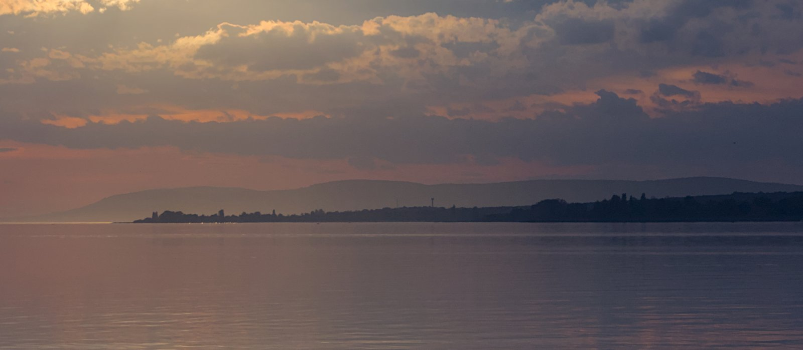

{fig-alt="Lake Balaton at dusk"}

# Welcome

As a researcher with an environmental engineering background, I work on freshwater ecology, phytoplankton and ecological modelling. I created this site to share how scientific thinking and data can help make sense of environmental issues, through posts shaped by my work and interests.

**Károly Pálffy**  
researcher,  
[Balaton Limnological Research Institute](https://www.blki.hun-ren.hu/en)
